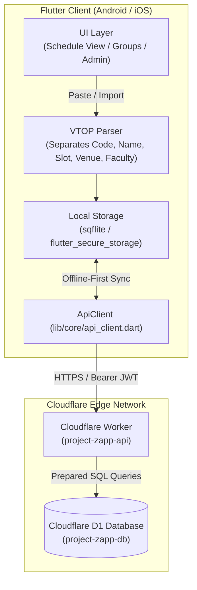

# Project Zapp — Cloudflare Backend & Database Integration Guide

This guide provides the complete architectural and implementation specification for integrating the **Project Zapp** Flutter application with **Cloudflare Workers** and **Cloudflare D1 (Serverless SQLite)**, addressing the requirements from [Zero-Bugs-Club/project-zapp](https://github.com/Zero-Bugs-Club/project-zapp) issues **#2 (Timetable Upload & View)**, **#3 (Cloudflare Backend & DB Overlap)**, and **#4 (Authentication & Admin Workflow)**, as well as Study Squad group management.

---

## 1. System Architecture



---

## 2. Cloudflare D1 Relational Database Schema

Save this file as `worker-backend/schema.sql`.

```sql
-- ============================================================================
-- 1. USERS & AUTHENTICATION TABLE
-- ============================================================================
CREATE TABLE IF NOT EXISTS users (
    id TEXT PRIMARY KEY,
    name TEXT NOT NULL,
    email TEXT NOT NULL COLLATE NOCASE UNIQUE,
    phone_number TEXT NOT NULL,
    username TEXT NOT NULL COLLATE NOCASE UNIQUE,
    password_hash TEXT NOT NULL,
    password_salt TEXT NOT NULL,
    role TEXT NOT NULL DEFAULT 'USER' CHECK (role IN ('USER', 'ADMIN')),
    status TEXT NOT NULL DEFAULT 'PENDING' CHECK (status IN ('PENDING', 'APPROVED', 'REJECTED')),
    created_at TEXT NOT NULL DEFAULT CURRENT_TIMESTAMP
);

CREATE INDEX IF NOT EXISTS idx_users_status ON users(status);
CREATE INDEX IF NOT EXISTS idx_users_username ON users(username);

-- ============================================================================
-- 2. COURSE REGISTRATIONS TABLE (Separated Structured Fields)
-- ============================================================================
CREATE TABLE IF NOT EXISTS courses (
    id TEXT PRIMARY KEY,
    user_id TEXT NOT NULL,
    course_code TEXT NOT NULL,         -- e.g. 'IASWE201'
    course_name TEXT NOT NULL,         -- e.g. 'Requirements Engineering and Management'
    slot TEXT NOT NULL,                -- e.g. 'A1+TA1+TAA1' or 'L31+L32'
    venue TEXT NOT NULL,               -- e.g. 'AB4-502'
    faculty_name TEXT NOT NULL,        -- e.g. 'RAMA PRABHA K P'
    created_at TEXT NOT NULL DEFAULT CURRENT_TIMESTAMP,
    FOREIGN KEY (user_id) REFERENCES users(id) ON DELETE CASCADE
);

CREATE INDEX IF NOT EXISTS idx_courses_user ON courses(user_id);
CREATE INDEX IF NOT EXISTS idx_courses_code ON courses(course_code);

-- ============================================================================
-- 3. USER TIMETABLE SLOTS TABLE (Deconstructed 7-Day Periods for Fast Matrix Queries)
-- ============================================================================
CREATE TABLE IF NOT EXISTS user_timetable_slots (
    id TEXT PRIMARY KEY,
    user_id TEXT NOT NULL,
    day_of_week INTEGER NOT NULL CHECK (day_of_week BETWEEN 1 AND 7), -- 1=Mon .. 7=Sun
    slot_code TEXT NOT NULL,           -- e.g. 'A1', 'L31', 'TB1'
    start_time TEXT NOT NULL,          -- e.g. '08:00'
    end_time TEXT NOT NULL,            -- e.g. '08:50'
    course_code TEXT NOT NULL,         -- Foreign reference to course
    venue TEXT NOT NULL,
    faculty_name TEXT NOT NULL,
    is_busy INTEGER NOT NULL DEFAULT 1 CHECK (is_busy IN (0, 1)),
    updated_at TEXT NOT NULL DEFAULT CURRENT_TIMESTAMP,
    FOREIGN KEY (user_id) REFERENCES users(id) ON DELETE CASCADE
);

CREATE INDEX IF NOT EXISTS idx_slots_user_day ON user_timetable_slots(user_id, day_of_week);
CREATE INDEX IF NOT EXISTS idx_slots_code ON user_timetable_slots(slot_code);

-- ============================================================================
-- 4. STUDY SQUADS / GROUPS TABLE
-- ============================================================================
CREATE TABLE IF NOT EXISTS groups (
    id TEXT PRIMARY KEY,
    code TEXT NOT NULL UNIQUE,         -- 8-character alphanumeric squad code, e.g. 'K8M2-9PL4'
    name TEXT NOT NULL,                -- e.g. 'Study Squad 1'
    description TEXT,
    created_by TEXT NOT NULL,
    created_at TEXT NOT NULL DEFAULT CURRENT_TIMESTAMP,
    FOREIGN KEY (created_by) REFERENCES users(id) ON DELETE CASCADE
);

CREATE INDEX IF NOT EXISTS idx_groups_code ON groups(code);

-- ============================================================================
-- 5. GROUP MEMBERSHIPS TABLE
-- ============================================================================
CREATE TABLE IF NOT EXISTS group_members (
    id TEXT PRIMARY KEY,
    group_id TEXT NOT NULL,
    user_id TEXT NOT NULL,
    role TEXT NOT NULL DEFAULT 'MEMBER' CHECK (role IN ('OWNER', 'ADMIN', 'MEMBER')),
    joined_at TEXT NOT NULL DEFAULT CURRENT_TIMESTAMP,
    FOREIGN KEY (group_id) REFERENCES groups(id) ON DELETE CASCADE,
    FOREIGN KEY (user_id) REFERENCES users(id) ON DELETE CASCADE,
    UNIQUE(group_id, user_id)
);

CREATE INDEX IF NOT EXISTS idx_group_members_group ON group_members(group_id);
CREATE INDEX IF NOT EXISTS idx_group_members_user ON group_members(user_id);

-- ============================================================================
-- 6. RATE LIMITING TABLE
-- ============================================================================
CREATE TABLE IF NOT EXISTS rate_limits (
    key TEXT PRIMARY KEY,
    attempts INTEGER NOT NULL DEFAULT 1,
    reset_at INTEGER NOT NULL
);

CREATE INDEX IF NOT EXISTS idx_rate_limits_reset ON rate_limits(reset_at);
```

---

## 3. Worker API Endpoints Specification

All endpoints are hosted at `https://<your-worker>.workers.dev`.

### A. Authentication
| Method | Endpoint | Auth | Description |
|---|---|---|---|
| `POST` | `/api/signup` | Public | Submits registration (Name, Email, Phone, Username, Password). Status becomes `PENDING`. |
| `POST` | `/api/login` | Public | Validates credentials; returns JWT token if `status == 'APPROVED'`. |
| `GET` | `/api/me` | Bearer | Returns the authenticated user's session profile. |
| `GET` | `/api/admin/pending` | Admin | Fetches all pending registration requests. |
| `POST` | `/api/admin/review` | Admin | Approves or rejects a pending registration (`status: 'APPROVED' \| 'REJECTED'`). |

### B. Timetable & Course Sync
| Method | Endpoint | Auth | Description |
|---|---|---|---|
| `POST` | `/api/timetable/upload` | Bearer | Uploads a batch of parsed `CourseRegistration` rows and expanded slot instances. |
| `GET` | `/api/timetable/my` | Bearer | Fetches the user's current uploaded timetable with all course metadata. |
| `DELETE` | `/api/timetable/my` | Bearer | Clears the user's uploaded timetable in D1. |

### C. Group / Squad Management & Overlap Engine
| Method | Endpoint | Auth | Description |
|---|---|---|---|
| `POST` | `/api/groups/create` | Bearer | Creates a squad with name, description, and auto-generated 8-character squad code. |
| `POST` | `/api/groups/join` | Bearer | Joins an existing squad using the 8-character squad code (`code: 'K8M2-9PL4'`). |
| `GET` | `/api/groups/my` | Bearer | Returns the list of squads the current user is a member of. |
| `GET` | `/api/groups/:id/overlap?day=1` | Bearer | Computes the multi-user schedule matrix for that squad on a given day (1=Mon..7=Sun). |

### D. Admin Matrix View
| Method | Endpoint | Auth | Description |
|---|---|---|---|
| `GET` | `/api/admin/timetable/matrix?day=1` | Admin | Returns the full institution grid showing busy/free breakdown across all students. |

---

## 4. Multi-User Timetable Overlap Calculation Logic

Issue #3 specifies calculating overlaps across **at least 2 users** to determine common free slots and display who is busy/free.

### Mathematical Algorithm:
For each day $d \in \{1 \dots 7\}$ and standard slot period $s \in \{\text{All 11 slots}\}$:
1. Query all group member IDs: $M = \{u_1, u_2, \dots, u_k\}$.
2. Query busy slot assignments from `user_timetable_slots` where `day_of_week = d` and `user_id` $\in M$.
3. For each slot $s$:
   - $\text{BusyUsers}(s) = \{u \in M \mid u \text{ has an assigned class at slot } s\}$.
   - $\text{FreeUsers}(s) = M \setminus \text{BusyUsers}(s)$.
4. Slot Status:
   - If $|\text{BusyUsers}(s)| == 0$: **Everyone is Free** (Green pill).
   - If $|\text{BusyUsers}(s)| == |M|$: **Nobody is Free** (Red / Solid busy).
   - Otherwise: **Partially Free** (Amber / Soft blue badge showing `X of Y free`).

---

## 5. Cloudflare Worker Implementation (`src/timetable.js`)

Below is the Worker handler implementing the upload and overlap logic:

```javascript
// Timetable upload handler
export async function handleTimetableUpload(request, env, user) {
  const { courses, slots } = await request.json();

  if (!Array.isArray(courses) || !Array.isArray(slots)) {
    return new Response(JSON.stringify({ error: "Invalid payload format" }), { status: 400 });
  }

  // Transaction: clear existing and insert new
  const queries = [
    env.DB.prepare("DELETE FROM courses WHERE user_id = ?").bind(user.id),
    env.DB.prepare("DELETE FROM user_timetable_slots WHERE user_id = ?").bind(user.id)
  ];

  for (const c of courses) {
    queries.push(
      env.DB.prepare(
        "INSERT INTO courses (id, user_id, course_code, course_name, slot, venue, faculty_name) VALUES (?, ?, ?, ?, ?, ?, ?)"
      ).bind(crypto.randomUUID(), user.id, c.courseCode, c.courseName, c.slot, c.venue, c.facultyName)
    );
  }

  for (const s of slots) {
    queries.push(
      env.DB.prepare(
        "INSERT INTO user_timetable_slots (id, user_id, day_of_week, slot_code, start_time, end_time, course_code, venue, faculty_name, is_busy) VALUES (?, ?, ?, ?, ?, ?, ?, ?, ?, 1)"
      ).bind(crypto.randomUUID(), user.id, s.dayOfWeek, s.slotCode, s.startTime, s.endTime, s.courseCode, s.venue, s.facultyName)
    );
  }

  await env.DB.batch(queries);

  return new Response(JSON.stringify({ success: true, count: courses.length }), {
    headers: { "Content-Type": "application/json" }
  });
}

// Group overlap handler
export async function handleGroupOverlap(request, env, groupId, day) {
  // 1. Fetch group members
  const { results: members } = await env.DB.prepare(
    "SELECT u.id, u.name, u.username FROM group_members gm JOIN users u ON gm.user_id = u.id WHERE gm.group_id = ?"
  ).bind(groupId).all();

  if (members.length === 0) {
    return new Response(JSON.stringify({ error: "Group not found or has no members" }), { status: 404 });
  }

  const memberIds = members.map(m => m.id);

  // 2. Fetch all busy slots for these members on the selected day
  const placeholders = memberIds.map(() => '?').join(',');
  const { results: busySlots } = await env.DB.prepare(
    `SELECT user_id, slot_code, course_code, venue FROM user_timetable_slots WHERE day_of_week = ? AND user_id IN (${placeholders})`
  ).bind(day, ...memberIds).all();

  // 3. Assemble matrix per standard slot
  const standardSlots = [
    { code: "A1/L1+L2", start: "08:00", end: "08:50" },
    { code: "F1/L3+L4", start: "08:55", end: "09:45" },
    { code: "D1/L5+L6", start: "09:50", end: "10:40" },
    { code: "TB1/L7+L8", start: "10:45", end: "11:35" },
    { code: "TG1/L9+L10", start: "11:40", end: "12:30" },
    { code: "A2/L31+L32", start: "14:00", end: "14:50" },
    { code: "F2/L33+L34", start: "14:55", end: "15:45" },
    { code: "D2/L35+L36", start: "15:50", end: "16:40" },
    { code: "TB2/L37+L38", start: "16:45", end: "17:35" },
    { code: "TG2/L39+L40", start: "17:40", end: "18:30" },
    { code: "V2/L41+L42", start: "18:35", end: "19:25" }
  ];

  const comparison = standardSlots.map(slot => {
    const busyInSlot = busySlots.filter(s => slot.code.includes(s.slot_code));
    const busyUserIds = new Set(busyInSlot.map(s => s.user_id));
    const freeMembers = members.filter(m => !busyUserIds.has(m.id));
    const busyMembers = members.filter(m => busyUserIds.has(m.id)).map(m => {
      const match = busyInSlot.find(s => s.user_id === m.id);
      return { id: m.id, name: m.name, courseCode: match?.course_code, venue: match?.venue };
    });

    return {
      slot: slot.code,
      time: `${slot.start} - ${slot.end}`,
      totalMembers: members.length,
      freeCount: freeMembers.length,
      isFullyFree: freeMembers.length === members.length,
      freeMembers: freeMembers.map(m => ({ id: m.id, name: m.name })),
      busyMembers
    };
  });

  return new Response(JSON.stringify({ groupId, day, comparison }), {
    headers: { "Content-Type": "application/json" }
  });
}
```

---

## 6. Updating the Flutter App (`lib/core/api_client.dart`)

Implement the pending `saveTimetable()` and new group overlap functions:

```dart
/// Uploads parsed courses and expanded timetable slots to Cloudflare D1.
Future<void> saveTimetable({
  required List<CourseRegistration> courses,
  required List<TimetableSlot> slots,
  http.Client? client,
}) async {
  if (_authToken == null) throw Exception('Please log in first.');

  final httpClient = client ?? http.Client();
  try {
    final payload = {
      'courses': courses.map((c) => c.toMap()).toList(),
      'slots': slots.map((s) => {
        'dayOfWeek': s.day,
        'slotCode': s.slotCode,
        'startTime': s.startTime,
        'endTime': s.endTime,
        'courseCode': s.courseCode,
        'venue': s.venue,
        'facultyName': s.facultyName,
      }).toList(),
    };

    final response = await httpClient.post(
      _endpoint('/api/timetable/upload'),
      headers: _headers,
      body: jsonEncode(payload),
    );

    if (response.statusCode < 200 || response.statusCode >= 300) {
      throw Exception(_readError(response));
    }
  } finally {
    if (client == null) httpClient.close();
  }
}

/// Fetches real-time overlap comparison for a Study Squad.
Future<List<Map<String, dynamic>>> fetchSquadOverlap({
  required String groupId,
  required int day,
  http.Client? client,
}) async {
  if (_authToken == null) throw Exception('Please log in first.');

  final httpClient = client ?? http.Client();
  try {
    final response = await httpClient.get(
      _endpoint('/api/groups/$groupId/overlap?day=$day'),
      headers: _headers,
    );

    if (response.statusCode < 200 || response.statusCode >= 300) {
      throw Exception(_readError(response));
    }

    final data = jsonDecode(response.body) as Map<String, dynamic>;
    return List<Map<String, dynamic>>.from(data['comparison'] as List);
  } finally {
    if (client == null) httpClient.close();
  }
}
```

---

## 7. Step-by-Step Cloudflare Setup Guide

### Step 1: Install Wrangler CLI & Authenticate
```bash
npm install -g wrangler
wrangler login
```

### Step 2: Create the D1 Database
```bash
wrangler d1 create project-zapp-db
```
*Note the returned `database_id` and paste it into `wrangler.toml` under `[[d1_databases]]`.*

### Step 3: Apply the Schema to D1
```bash
# Local development test:
wrangler d1 execute project-zapp-db --local --file=./schema.sql

# Production cloud deployment:
wrangler d1 execute project-zapp-db --remote --file=./schema.sql
```

### Step 4: Seed Default Administrator Account
```bash
wrangler d1 execute project-zapp-db --remote --command="INSERT INTO users (id, name, email, phone_number, username, password_hash, password_salt, role, status) VALUES ('admin-1', 'Super Administrator', 'admin@zapp.internal', '9999999999', 'admin', 'HASH_HERE', 'SALT_HERE', 'ADMIN', 'APPROVED');"
```

### Step 5: Deploy the Cloudflare Worker
```bash
wrangler deploy
```

### Step 6: Configure Flutter Base URL
Update `lib/core/constants.dart`:
```dart
const String apiBaseUrl = 'https://project-zapp-api.<your-subdomain>.workers.dev';
```

---

## 8. Summary of Benefits

1. **Clean Separation of Data**: Course codes, names, slots, venues, and faculties are stored in normalized relational columns instead of raw strings.
2. **Deterministic Overlap Engine**: Computing free/busy matrices directly on Cloudflare D1 reduces network latency to <50ms globally.
3. **Dual Storage Strategy**: Local storage (`sqflite`) maintains instantaneous offline rendering, while Cloudflare D1 sync enables squad-level coordination and admin oversight.
